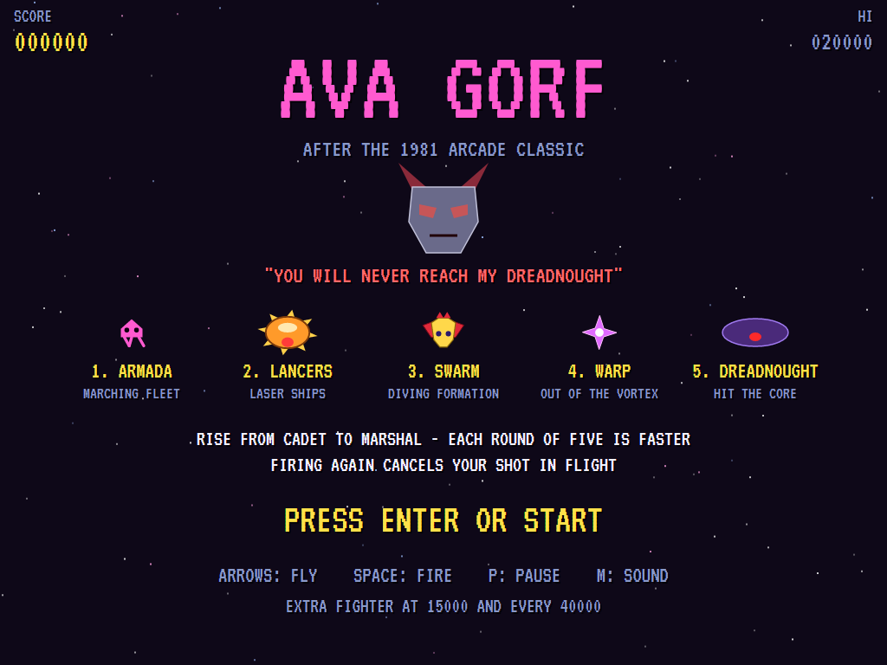
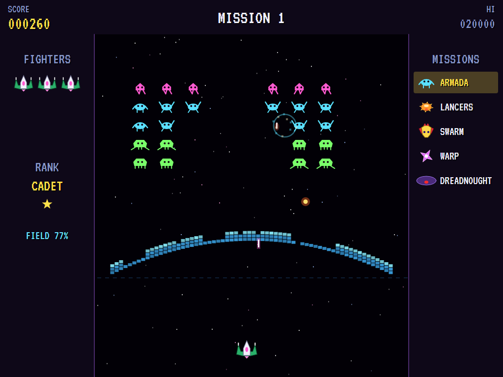
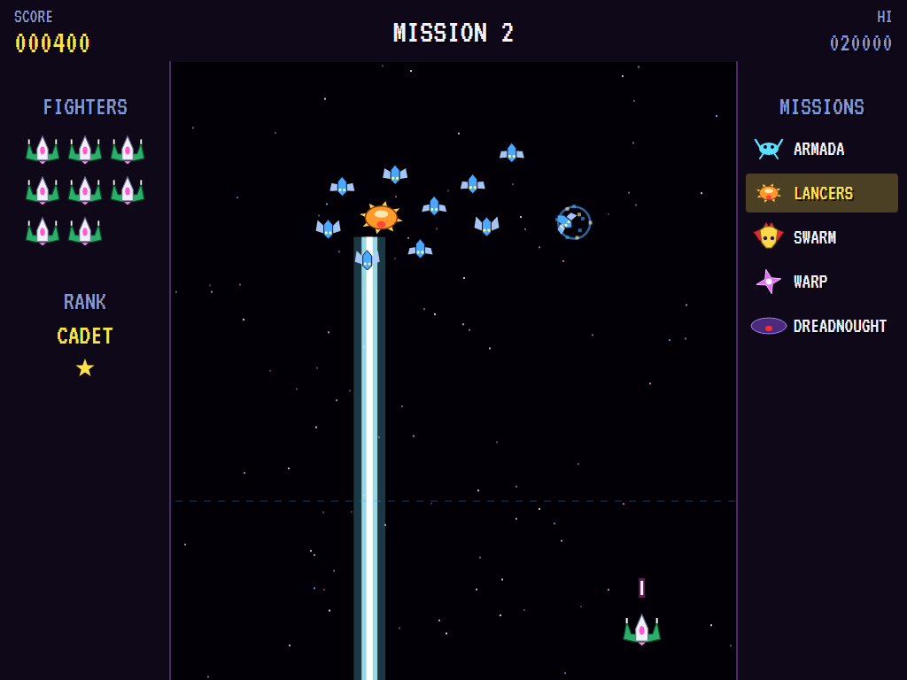
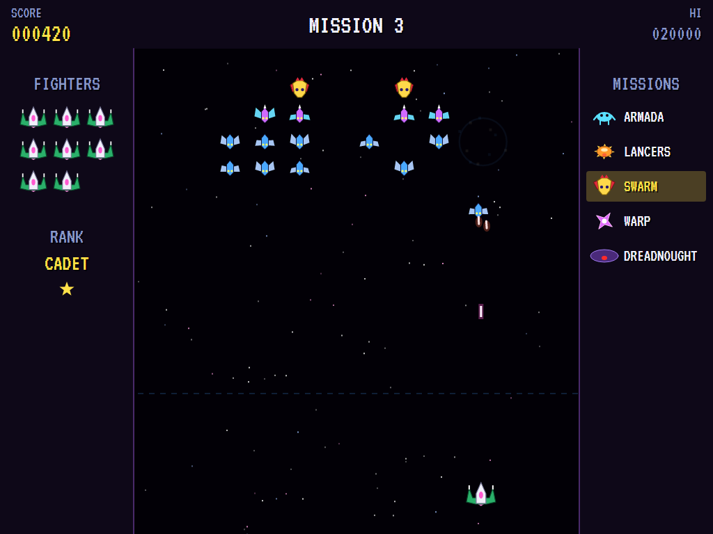
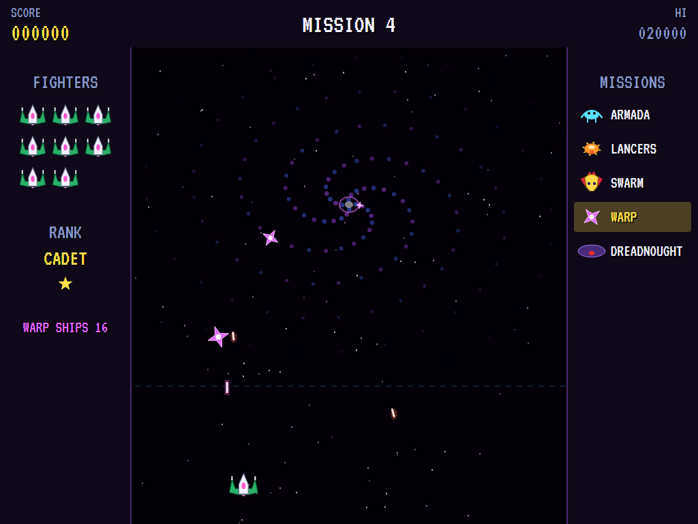
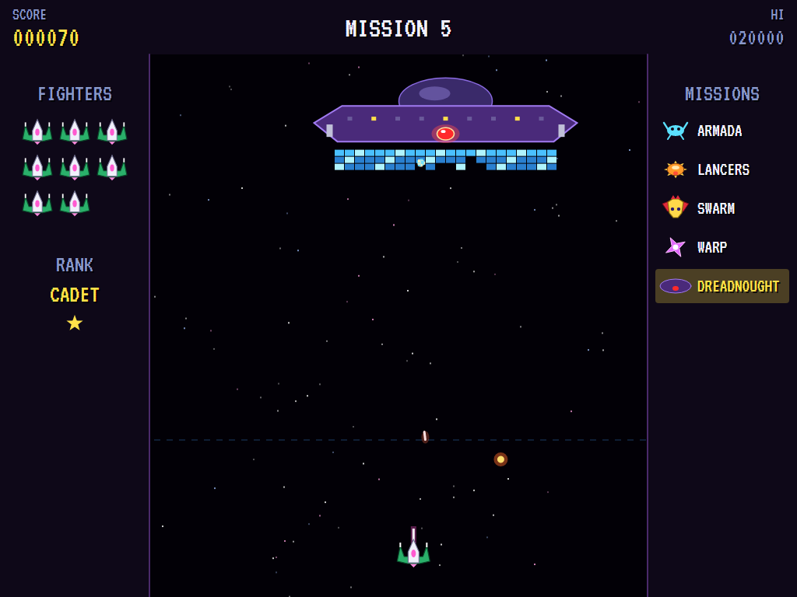
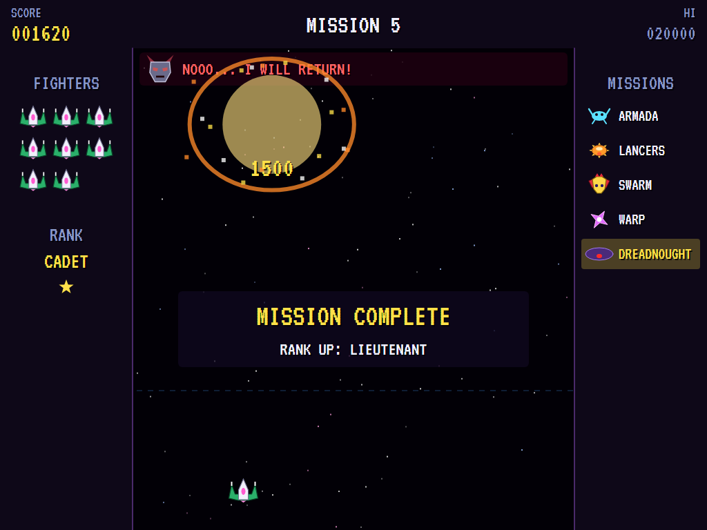
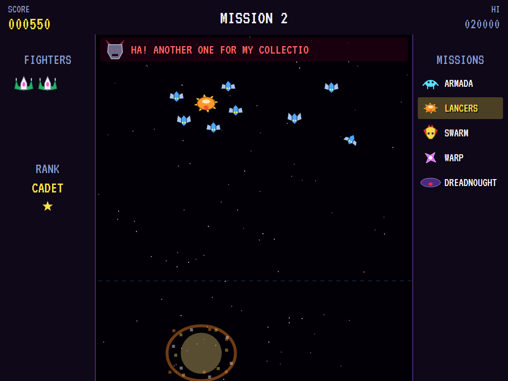
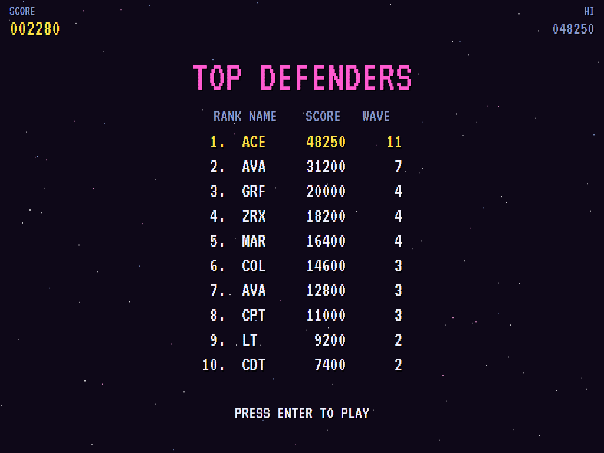

# AVA Gorf

[](https://github.com/Harlock123/AVAGorf/actions/workflows/build.yml)

A five-mission space shooter in the style of the 1981 arcade game **Gorf**, built with .NET 10 and
Avalonia UI. Fight through a marching armada, laser-firing Lancers, a diving swarm and ships pouring out
of a warp, then take on the Overlord's Dreadnought. The Overlord taunts you all the way. Win all five and
you go up a rank, from Cadet to Marshal, and round again, faster.

## Features

- **Your fighter**:
  - **Flying:** it flies left, right, up and down about the bottom of the screen, below the dashed line.
  - **Firing:** it fires one beam at a time, and firing again cancels the beam in flight and fires a fresh one. A quick second press can save a shot that's going to miss, but it can also throw away a shot that was about to hit.
- **The five missions**:
  1. **The Armada:** forty invaders in five rows march from side to side, stepping down at each edge and going faster as their numbers fall.
     - **The force field:** an arch of force shelters you. Your beam passes through it, but their bullets and bombs wear it away, a bomb taking a bigger bite.
     - **Landing:** if the Armada reaches your zone, you lose a fighter and the fleet goes back to the top.
  2. **The Lancers:** two orange laser ships drift about, each circled by a ring of six fighters.
     - **The beam:** a Lancer warns with a flickering line, then fires a beam straight down to the bottom of the screen.
     - **The fighters:** they break off now and then to dive at you, firing.
  3. **The Swarm:** a swaying formation of drones, stingers and crested leaders. They peel off to loop out and dive at you, and the last four attack without a break.
  4. **The Warp:** ships spin out of the eye of a vortex one after another, firing as they spiral wider. They're worth most if you hit them while they're still near the eye. Any that get away go back in and come out again.
  5. **The Dreadnought:** the Overlord's flagship drifts from side to side, firing from cannons at both ends and dropping bombs.
     - **The band:** under the reactor core is a three-layer shield band that slowly turns and mends itself.
     - **Destroying it:** shoot a hole through the band and hit the core.
- **The Overlord:** a horned steel mask that speaks in a robotic warble. It greets each mission and jeers when you lose a fighter, in lines of its own: "IS THAT YOUR BEST, CADET?"
- **Ranks**: Cadet, Lieutenant, Captain, Colonel and Marshal. Each round of five missions is faster, with more bullets in the air, more divers at once, more warp ships, and a quicker Dreadnought.
- **Scoring**:

  | | Points |
  |---|---|
  | Armada invaders | 30, 20 or 10 by row |
  | Lancer fighters | 50 in the ring, 100 diving |
  | Lancers | 300 |
  | Swarm drones / stingers / leaders | 50, 40 or 60 in place; 100, 80 or 200 diving |
  | Warp ships | 300 near the eye, 150 further out, 80 at the edge |
  | Dreadnought | 10 for each band cell; the core 1,500, plus 500 for each rank |

  - **Extra fighters** come at 15,000 and every 40,000 after that.
- **Sound**:
  - **The title tune:** an original menacing march in E minor.
  - **The effects:** the fighter's twang, the Armada's thudding march, the Lancers charging and firing, the warp's swirl, the core alarm and the Dreadnought exploding, the Overlord's robotic voice and the throb of his engines, plus jingles.
  - All of it is synthesised and mixed by OpenAL.
- **Attract mode**: leave the title alone for 15 seconds and a computer pilot plays a mission picked at random.
  - It looks a moment ahead for bullets, divers, warp ships and Lancer beams, and slips aside from them.
  - Otherwise it lines up under the best target, leading it so the beam meets it, and fires only once its last shot is spent.
- **A top-ten high-score table** with arcade-style initials entry. It records the mission reached.
- **Gamepads** through SDL2, as well as the keyboard.
- **Any window size**: the screen scales to fit, letterboxed. **Ctrl+S** saves a screenshot.
- **One self-contained executable** per platform: Windows, macOS and Linux on Intel/AMD and ARM.

## Screenshots

| The title | The Armada | The Lancers |
|:---------:|:----------:|:-----------:|
|  |  |  |
| The five missions. | The force field wearing thin. | A Lancer's beam. |

| The Swarm | The Warp | The Dreadnought |
|:---------:|:--------:|:---------------:|
|  |  |  |
| Divers coming down. | Out of the vortex. | Boring through the band. |

| The core hit | Shot down | Top defenders |
|:------------:|:---------:|:-------------:|
|  |  |  |
| Down goes the Dreadnought. | The Overlord gloats. | The high-score table. |

The screenshots are made by the tests, which play the game in a real (headless) window; see
[Tests](#tests).

## Download and run

Ready-to-run builds for Windows, macOS and Linux, on both Intel/AMD and ARM, are on the
[Releases page](https://github.com/Harlock123/AVAGorf/releases/tag/latest). **Latest build** is
rebuilt on every push to `main`. Each download is one self-contained executable: no .NET install is
needed.

| Platform | Archive |
|---|---|
| Windows | `AVAGorf-win-x64.zip`, `AVAGorf-win-x86.zip`, `AVAGorf-win-arm64.zip` |
| macOS | `AVAGorf-osx-arm64.tar.gz` (Apple silicon), `AVAGorf-osx-x64.tar.gz` (Intel) |
| Linux | `AVAGorf-linux-x64.tar.gz`, `AVAGorf-linux-arm64.tar.gz`, `AVAGorf-linux-arm.tar.gz` |

```bash
tar -xzf AVAGorf-linux-x64.tar.gz     # or linux-arm64, linux-arm, osx-arm64, osx-x64
./AVAGorf
```

On Windows, unzip and run `AVAGorf.exe`. On macOS, if Gatekeeper refuses to open it, run
`xattr -d com.apple.quarantine AVAGorf` once. Run with `--no-audio` for silence.

**Sound** comes through OpenAL Soft, built in for every platform. In a virtual machine the game
detects it and uses a larger audio buffer, so the sound doesn't break up.

**Gamepads** use SDL2, which is bundled for Windows, macOS and Intel/AMD Linux. ARM Linux builds need it
installed; without it the keyboard still works:

```bash
sudo apt install libsdl2-dev            # Debian / Ubuntu / Raspberry Pi OS
sudo pacman -S --needed sdl2-compat     # Arch / Omarchy
```

## Controls

| Input | Action |
|-------|--------|
| **Enter** | Start |
| **Arrows** (or **WASD**, or the numeric keypad) | Fly |
| **Space** / **Z** / **X** / **Ctrl** | Fire (a fresh press for each shot; firing again cancels the one in flight) |
| **P** / **Esc** | Pause (Esc again to quit) |
| **M** | Mute |
| **Ctrl+S** / **Cmd+S** | Save a screenshot to the Pictures folder |

**Gamepad**: left stick or D-pad to fly, **A**, **B** or **X** to fire, **Start** to start and pause,
**Back** (while paused) to quit.

**Entering initials**: type letters, or dial with **Up**/**Down** and accept with **Space**; **Left** /
**Backspace** go back; **Enter** finishes.

## Tests

```bash
dotnet test AVAGorf.slnx
```

The engine has no UI and runs in fixed 60 Hz steps, so it plays the same at any frame rate, and a seed
always plays the same game. The tests check:

- **The missions:**
  - the five in order, then round again a rank higher and faster
  - each one's enemy
  - the opening words
- **The fighter:**
  - flying about its zone and no further
  - a second press cancelling the shot in flight
- **The Armada:**
  - marching and stepping down
  - points by row
  - the force field letting your beam through but worn away by bullets and bombs
  - the landing
- **The Lancers:**
  - the rings circling them
  - the beam warning, then burning
  - a shot Lancer's beam stopping
- **The Swarm:**
  - divers looping out and coming round home
  - rammers going down too
- **The Warp:**
  - ships spiralling out, and their points by distance
  - the mission won when all of them are shot
- **The Dreadnought:**
  - the band shot through before the core
  - the hull stopping shots beside the core
  - the band turning and mending
  - the promotion that follows
- **The machine:** losing fighters and the Overlord's jeers, the last fighter and initials, extra fighters, the attract cycle, the computer pilot winning a whole round, the same game from the same seed, and pausing

The screenshot tests draw the real screen in a headless window. To refresh the README's pictures:

```bash
GORF_SHOTS=$PWD/Images dotnet test tests/AVAGorf.Tests --filter ScreenshotTests
```

To see how the computer pilot gets on, mission by mission (for tuning), or how a player who just sits in
the middle and fires once a second does (`GORF_PROBE=lazy`):

```bash
GORF_PROBE=1 dotnet test tests/AVAGorf.Tests --filter PilotProbe --logger "console;verbosity=detailed"
```

## Building

```bash
dotnet build AVAGorf.slnx
dotnet run --project src/AVAGorf
```

Needs the .NET 10 SDK. The sounds are made by `tools/make_sounds.py` (standard-library Python):
`python3 tools/make_sounds.py` rewrites `src/AVAGorf/Sounds`.

## Project structure

```
AVAGorf/
├── AVAGorf.slnx
├── src/AVAGorf/
│   ├── Engine/
│   │   ├── GameEngine.cs        # States, the title and demo cycle, and the Overlord's engines
│   │   ├── GameEngine.Play.cs   # The fighter and its beam, the five missions, the Overlord's words,
│   │   │                        # ranks, and scoring
│   │   ├── ShipPilot.cs         # The computer pilot, for the demonstration (and the tests)
│   │   ├── Entities.cs          # The field, the fighter, shots, bullets, foes, beams, the force field
│   │   │                        # and the Dreadnought
│   │   ├── HighScoreTable.cs, InitialsEntry.cs
│   │   ├── InputHandler.cs, ControllerManager.cs  # Keys and an SDL2 gamepad
│   │   └── SoundManager.cs      # Effects and the tunes through OpenAL
│   ├── Audio/                   # The OpenAL engine (from the author's AVABand)
│   ├── Views/                   # The starfield, the vortex, the fighter, the enemy, the Overlord,
│   │                            # the panels, the screens
│   └── Sounds/                  # The synthesised effects, the Overlord's voice and the tunes
├── tests/AVAGorf.Tests/         # Gameplay, screenshot and probe tests
├── tools/make_sounds.py
└── Images/                      # Screenshots
```

## About and licence

AVA Gorf © 2026 Lonnie Watson, under the [MIT License](LICENSE).

*Gorf* © 1981 Midway; the name belongs to its current owner. AVA Gorf is an independent, unofficial game
in its style. Its fighter, its missions, its Armada, Lancers, Swarm, warp ships and Dreadnought, its
Overlord and everything he says, its ranks, graphics, sounds, tunes and code are its own; nothing is taken
from the arcade machine's program, graphics, speech, sound or music. It is not affiliated with or endorsed
by any rights holder.
